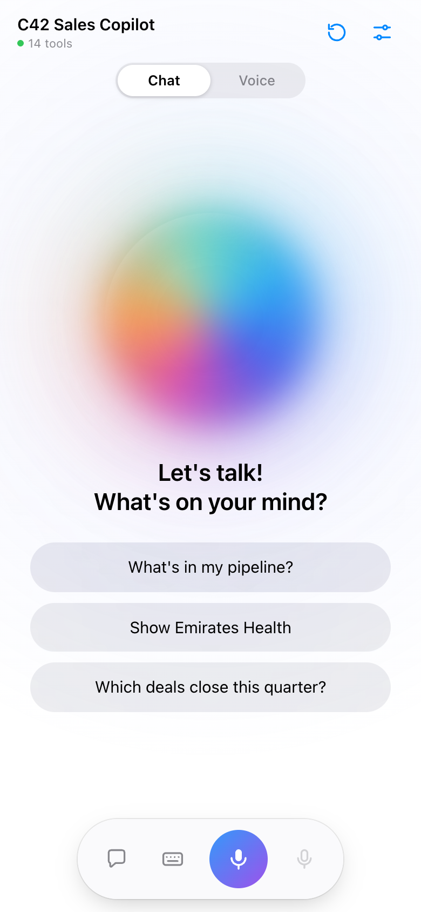
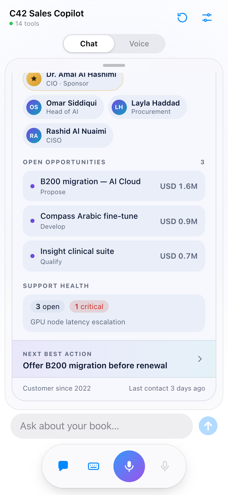
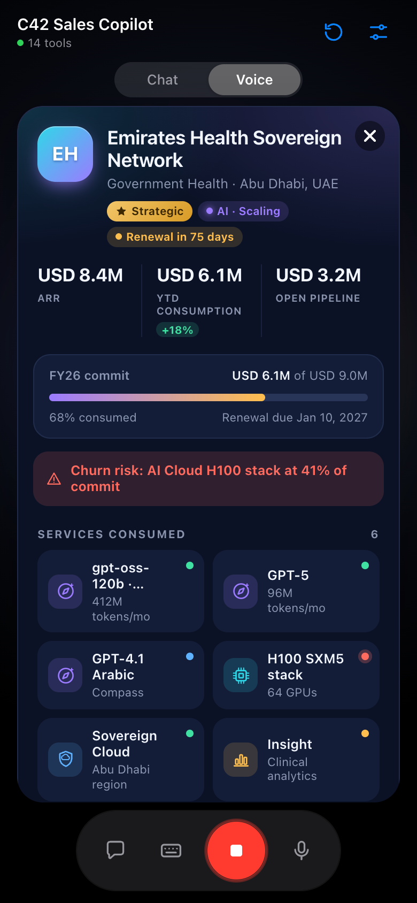
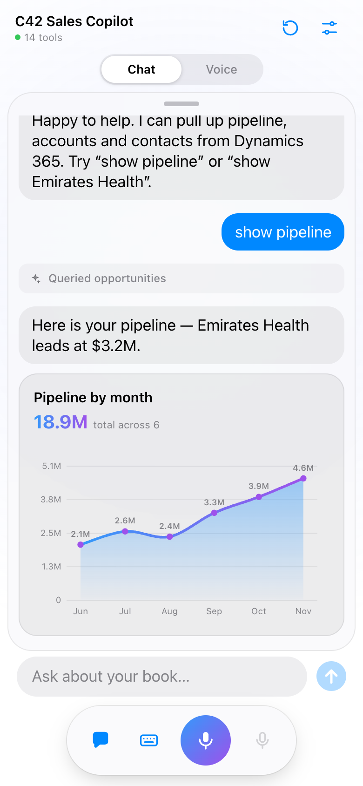
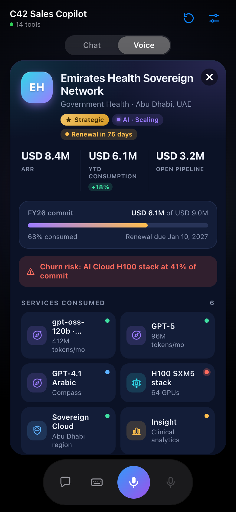
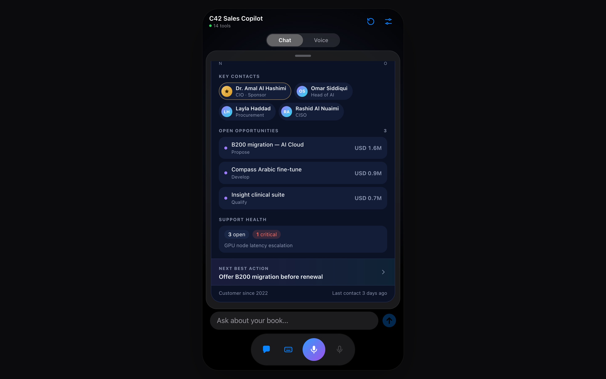

# C42 Sales Copilot

A Power Apps **code app** (React + Vite + TypeScript) for Dynamics 365 sellers: a chat and **voice** copilot (Azure AI Foundry `gpt-realtime`) with a Core42-style **Account 360** card. It runs inside Power Apps on desktop and mobile.

| Stage | Account 360 + transcript | Voice listening |
|---|---|---|
|  |  |  |

| Chart | Voice + card overlay | Desktop |
|---|---|---|
|  |  |  |

> ## ⚠️ Demo-grade disclaimer
> This is a **demonstration / proof-of-concept**, provided **as is**, with no warranty or support. It is **not production-ready**: it has not been security-reviewed, load-tested or accessibility-audited. All sample data (accounts, people, figures) is **fictional**. You are responsible for reviewing it, for the cost of the Azure/Power Platform resources it uses, and for compliance with your organisation's policies. Not an official Microsoft or Core42 product.

## Architecture

- **Code app** calls everything through Power Platform connectors (the app iframe CSP blocks direct network calls).
- **Dataverse** connector: accounts, opportunities, subscriptions, consumption, app logs.
- **Work IQ MCP** connector: meetings, mail, people (needs Microsoft 365 Copilot licensing).
- **Two custom connectors** to Azure AI Foundry: one mints a short-lived realtime client secret, the other does the WebRTC SDP exchange. The Foundry host is passed in an `x-foundry-host` header and validated against an allow-list of Azure domains.
- On start the app finds the Dataverse environment that has the `c42_*` environment variables and **connects to it automatically**. A picker appears only if it can't decide.

No keys, endpoints, tenant IDs or client IDs are in this repo. The solution ships **without environment-variable values**.

## Contents

| Path | What |
|---|---|
| `solution/C42SalesCopilot_managed.zip` | Managed solution (install this) |
| `solution/C42SalesCopilot_unmanaged.zip` | Unmanaged solution (for customising) |
| `app/` | Code app source |
| `connector/` | Custom connector definitions and scripts (secrets removed) |
| `solution/C42SalesCopilotDemoData_*.zip` | Optional solution with the **demo-data seeder** web resource |
| `webresource/` | Seeder source (`template.html` + `build.py`) |
| `seed/seed_data.py` | Fictional demo-data definitions |

## Prerequisites

- Power Platform environment with Dataverse, and **Premium** licences (custom + MCP connectors).
- Azure AI Foundry resource with a `gpt-realtime` deployment; users need *Cognitive Services OpenAI User* (or equivalent) on it.
- Your own **Entra app registration** for the Foundry connector (OAuth, scope `https://cognitiveservices.azure.com/.default`). You enter the client ID/tenant when creating the connection.
- The solution expects Account 360 columns on `account` (e.g. `c42_customertier`, `incpt_*`) and on `product`; add or adapt them in your environment.

## Install

1. Import `C42SalesCopilot_managed.zip` (Solutions → Import).
2. When prompted, create the connections: Dataverse, Work IQ MCP, and the two Foundry connectors (sign in; supply your Entra client ID / tenant for OAuth).
3. Fill in the environment variables:

| Variable | Example |
|---|---|
| `c42_FoundryEndpoint` | `your-resource.openai.azure.com` (host only) |
| `c42_RealtimeDeployment` | `gpt-realtime` (your deployment name) |
| `c42_RealtimeVoice` | `marin` |
| `c42_DebugLogging` | `false` |

4. *(Optional)* Import `C42SalesCopilotDemoData_managed.zip`, then open
   `https://<your-org>.crm.dynamics.com/WebResources/c42_/seed/seeddata.html` (in a browser signed in as an admin) and click **Seed demo data**. It creates 8 fictional Core42 customers with contacts, subscriptions, 6-12 months of consumption, pipeline, closed-won deals, cases and activities, plus a small Core42 product catalog. Dates are relative to today, it is safe to re-run, and **Remove demo data** deletes only what it created. It uses your own sign-in; nothing is hard-coded.
5. Share the app with users (and grant Dataverse security roles + Foundry access).
6. Open the app in Power Apps (desktop or mobile). It reads the variables and connects automatically.

## Build from source

```bash
cd app && npm install && npm run build
pac auth create --environment <env-url>
pac code init   # creates power.config.json for your env
pac code push
```
Re-add the data sources with `pac code add-data-source` and run `node patch-datasources.mjs` after regenerating connector services.

## Notes

- iPhone: the Power Apps mobile host letterboxes code apps; that's outside the app's control.
- Connector changes take ~2 minutes to propagate.
